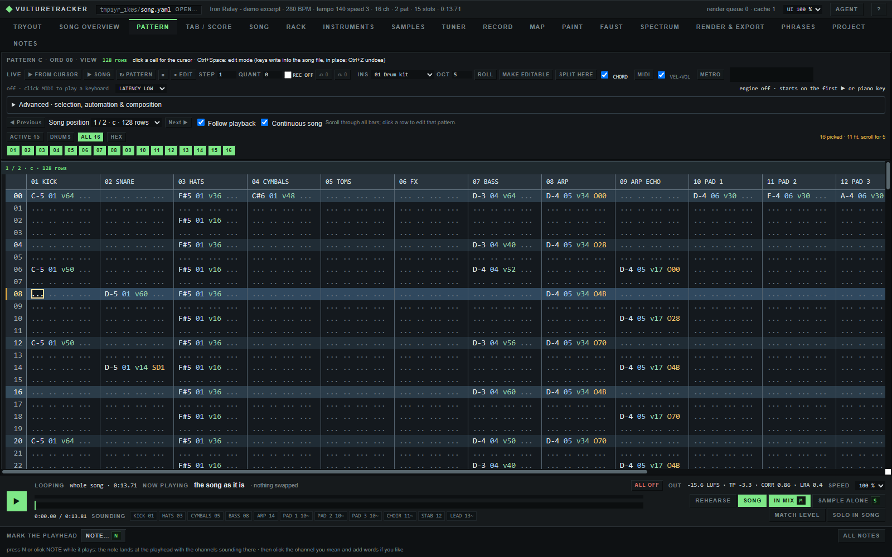
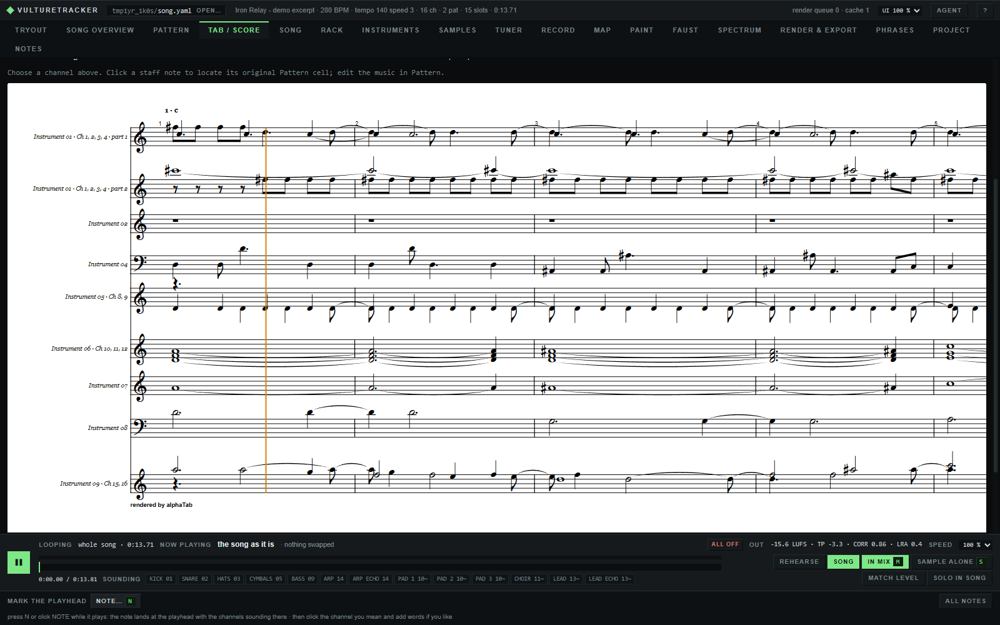
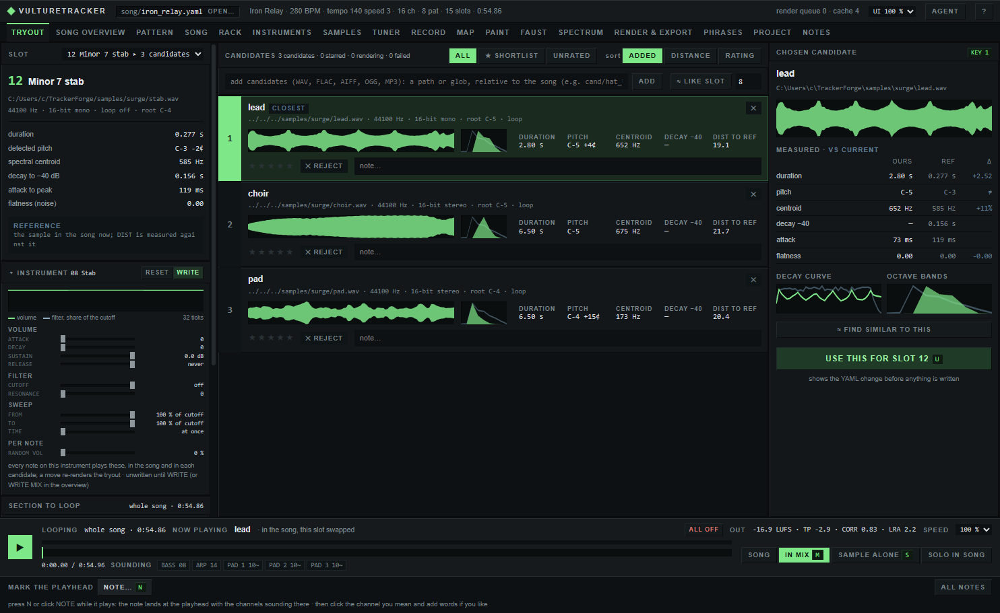
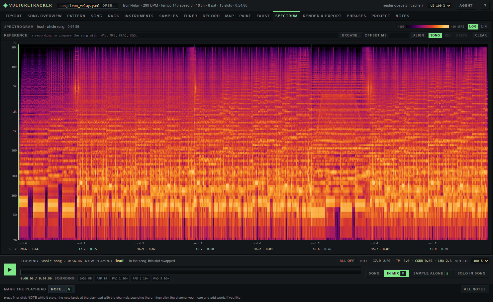

# VultureTracker


A music tracker with pattern, score and tablature views. Songs are readable YAML files that compile
to Impulse Tracker modules and play through libopenmpt. Edit in the app or in text, with undo and
validation before each save.

## Install

**Windows:** [Download the latest release](https://github.com/shadoh420/VultureTracker/releases/latest),
extract `vulturetracker-win64.zip`, and run `vulturetracker.exe`. Keep `ffmpeg.exe` beside it.
The app is unsigned; Windows SmartScreen may show an unknown-publisher warning.

<details>
<summary>Verify your download</summary>

Run `Get-FileHash vulturetracker.exe` in PowerShell and compare it with the release notes.
The SHA-256 for **1.10.0** is:

```text
ec0711e7141b3a47b33f4e986739b019bfbdbe62f690723253f74ba5340e0932
```

</details>

## Make music

- **Patterns:** readable channels, OpenMPT-style editing, MIDI input, automation and composition tools.
- **Score and TAB:** native editing, Guitar Pro/TuxGuitar import, and full-song tracker notation with
  grouped parts, playback follow and PDF printing. Tracker notation uses row-grid rhythm; effects and
  sample tuning are not transcribed.
- **Sounds:** audition samples inside the song, edit and record audio, or generate sounds with synth recipes and Faust.
- **Export:** IT, WAV, MP3, OGG, FLAC, MIDI, stems and game loops. Inspect loudness and spectra before exporting.
- **Optional AI:** an agent panel and MCP tools work on the open song. AI is off until you choose a provider.





<details>
<summary>Sound auditioning and spectrum analysis</summary>





</details>

## Run from source

Python 3.10+; tested on Windows and Linux. Outside Windows, install libopenmpt first.

```sh
git clone https://github.com/shadoh420/VultureTracker.git
cd VultureTracker
pip install -e ".[all]"
python -m vulturetracker gui demo2/iron_relay.yaml
```

Native score playback needs the [patched engine](THIRD_PARTY.md#patched-engine-source-and-reproduction),
included in the Windows download. Run `python -m vulturetracker --help` for import, build and render commands.

## Help and details

[User guide](GUIDE.md) · [Song format](SONG_FORMAT.md) · [Sample recipes](SAMPLING.md) ·
[Score interchange limits](TABLATURE-PARITY.md) · [Changelog](CHANGELOG.md) ·
[Report a bug](https://github.com/shadoh420/VultureTracker/issues/new/choose)

The app runs locally with no telemetry. If you enable an AI provider, prompts and tool results go to
that provider. See the [guide](GUIDE.md#gui-choosing-samples-in-context) for settings, saved files and agent setup,
and [SECURITY.md](SECURITY.md) for private vulnerability reports.

Source code: [MIT](LICENSE). The packaged Windows app includes GPL-3.0 components; see
[THIRD_PARTY.md](THIRD_PARTY.md) for licenses and source information. Demo credits and musical provenance
are in [PROVENANCE.md](PROVENANCE.md) and the sample attribution files.

## Reporting a problem

Use the [bug form](https://github.com/shadoh420/VultureTracker/issues/new/choose) with your version,
reproduction steps and `%APPDATA%\VultureTracker\vulturetracker.log`. Report security issues privately via
[SECURITY.md](SECURITY.md).
